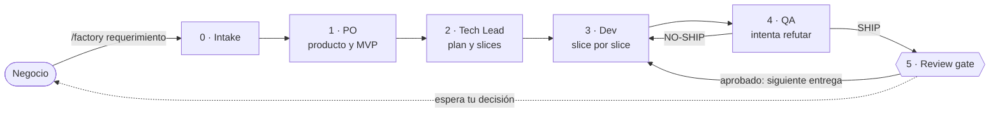

# Software Factory (Claude Code)

Fábrica de software autónoma para Claude Code sobre **brainloom-claude**. Vos sos el **Negocio**: entregás un requerimiento y la fábrica — Product Owner, Tech Lead, Dev y QA como subagents — lo construye end-to-end y se detiene una sola vez, en la **review gate**, para que apruebes el MVP y el roadmap.

Se instala **por proyecto**, dentro de su `.claude/`. No escribe nada en `~/.claude`.



## Demo: una corrida real

Todo lo de [`examples/demo-gastos/`](examples/demo-gastos) lo produjo la fábrica a partir de este pedido, sin intervención hasta la gate:

```
/factory CLI en Node que lee un CSV de gastos (fecha,categoria,monto) y muestra el total
por categoría y el total general, para freelancers que llevan sus cuentas en planillas.
Stack impuesto: Node 20, cero dependencias.
```

| Fase | Rol | Qué entregó |
|---|---|---|
| 0 | orquestador | [`intake.md`](examples/demo-gastos/factory/intake.md) y, como hay dinero de por medio, una división sintetizada: [`division.md`](examples/demo-gastos/factory/division.md) (centavos enteros, nunca silenciosamente mal, CSV hostil) |
| 1 | PO | [`product.md`](examples/demo-gastos/factory/product.md): MVP de 4 historias, 3 más al roadmap, y 4 [nodos](examples/demo-gastos/brain/nodes) con criterios observables |
| 2 | Tech Lead | [`plan.md`](examples/demo-gastos/factory/plan.md): 3 slices, y la decisión cara registrada en [`D-0001`](examples/demo-gastos/brain/decisions/D-0001.md) |
| 3 | Dev ×3 | [código](examples/demo-gastos/src) + [tests](examples/demo-gastos/test): 5 → 11 → 12 tests verdes, cada nodo cerrado con su evidencia |
| 4 | QA | [`qa-report.md`](examples/demo-gastos/factory/qa-report.md): **SHIP**, 0 críticos, 1 hallazgo menor |
| 5 | orquestador | el tablero de abajo y la gate |


Lo que el Negocio recibe en la **review gate**, y donde la fábrica se detiene:

> **MVP**: `node bin/gastos.js examples/gastos.csv` imprime el total por categoría y el general, exactos al centavo. Un CSV inválido da `Error: línea n`, código de salida 1 y ningún total.
> **Verificación**: QA dice SHIP. 12/12 tests. Un hallazgo menor: una categoría con salto de línea entre comillas se imprime en dos líneas. Sin probar: archivos grandes y terminadores `\r` solos.
> **Roadmap**: filtro por rango de fechas, totales por mes, exportar.
> **Decisiones para vos**: 1) ¿Aceptar `;` como separador, el que exporta Excel en español? Recomendado: sí, en la próxima entrega. 2) ¿Fechas `DD/MM/AAAA` además de `AAAA-MM-DD`? Recomendado: no por ahora.

Probalo vos:

```bash
cd examples/demo-gastos
node --test
node bin/gastos.js examples/gastos.csv
```

Costo medido de esta corrida: 6 lanzamientos de subagents, unos 274 mil tokens entre todos y cerca de 7 minutos de trabajo de agentes. No incluye los tokens del orquestador.

## Instalar en un proyecto

Requisito: `node`.

```bash
node install.mjs <carpeta-del-proyecto>              # instala o actualiza
node install.mjs <carpeta-del-proyecto> --uninstall  # la quita; brain/ y factory/ quedan
```

Qué deja en `<proyecto>/.claude/`:

```
skills/factory/        orquestador (/factory), board.mjs, references/, divisions/
skills/brainloom/      flujo de build de brainloom-claude
agents/                factory-po, factory-tech-lead, factory-design, factory-dev, factory-qa
                       + planner, scout, verifier (brainloom-claude)
brainloom-claude/      init.mjs y templates para crear brain/ sin tokens
```

Reinstalar es seguro: esas rutas se borran antes de copiar. Son del kit; no guardes ahí archivos propios. El resto de `.claude/` (settings, otros agents) no se toca.

### Con GitHub Actions

Copiá [`examples/install-factory.yml`](examples/install-factory.yml) a `.github/workflows/` del proyecto destino. Desde Actions → **Install software factory** → *Run workflow*, instala o actualiza la fábrica y commitea `.claude/` en la rama elegida.

O usá la action en un workflow propio (instala, no commitea):

```yaml
- uses: actions/checkout@v4
- uses: fedesauzzadev/software-factory-claude@main
```

Para que funcione:
- Este kit tiene que estar publicado en GitHub como `fedesauzzadev/software-factory-claude` (o cambiá el `uses:`).
- Si el kit es privado: en su repo, Settings → Actions → General → Access, permití el acceso desde tus otros repos.
- El proyecto destino no puede tener `.claude` en `.gitignore`, y la rama no puede estar protegida contra push del workflow.

## Usar

```
/factory Una API que genere facturas PDF desde JSON, en Node, vendible a contadores
/factory                      # estado del proyecto actual
```

| Fase | Quién | Entrega |
|---|---|---|
| 0 Intake | orquestador | `factory/intake.md`, `brain/` (script, cero tokens), tamaño de corrida, división |
| 1 Producto | `factory-po` | `factory/product.md`: spec, backlog con corte MVP ≤4, roadmap; nodos `planned` |
| 2 Plan | `factory-tech-lead` (+ `factory-design` si hay UI) | `factory/plan.md`, decisiones, comandos |
| 3 Build | `factory-dev`, slice por slice | código + tests + nodos `verified` con evidencia |
| 4 QA | `factory-qa` | `factory/qa-report.md` con SHIP / NO-SHIP |
| 5 Gate | orquestador | `factory/board.html` + MVP, verificación, roadmap, decisiones → **espera tu aprobación** |

## Dónde ahorra tokens

| Mecanismo | Efecto |
|---|---|
| Corrida **Lite** | una historia clara salta PO y Tech Lead: nodo + build + QA |
| Deltas ruteados por tamaño | cambios refinados o S no pasan por la fábrica |
| `board.mjs` | el tablero lo genera un script, no el modelo, y solo en la gate o a demanda |
| Roles devuelven ≤8 líneas | el orquestador no relee ni reescribe artefactos |
| Un archivo por rol | `product.md`, `plan.md`, `design.md`, `qa-report.md` |
| Modelo por rol | Tech Lead en opus, el resto en sonnet |
| QA una vez por MVP | y re-verifica solo lo que falló |
| Sin Scrum Master ni oficina | el estado sale de `brain/index.md` y `factory/log.md` |

## Reglas de la casa

- Nada está hecho sin un comando corrido y su resultado observado.
- Anti-bloqueo: 3 intentos distintos → Tech Lead → degradar con deuda explícita. Nunca se esconde.
- Sin DoD vendible (README, LICENSE, tests verdes, sin secrets) no hay SHIP.
- **Divisiones**: si el dominio lo exige, la fábrica suma gates propios (caché en `divisions/` o síntesis en `factory/division.md`); las que rinden se promueven al kit con tu aprobación.

## Desarrollar el kit

```bash
node scripts/test.mjs   # estructura + install x2 + init + board + uninstall, en un temp dir
```

```
install.mjs                 instalador y desinstalador por proyecto
action.yml                  GitHub Action (composite) que corre el instalador
examples/                   workflow listo para copiar al proyecto destino
agents/factory-*.md         po, tech-lead, design, dev, qa
skills/factory/             SKILL.md (orquestador), board.mjs, references/, divisions/
vendor/brainloom-claude/    copia de brainloom-claude (MIT) que se instala junto
scripts/test.mjs            self-check (local y CI)
```

Actualizar brainloom-claude: reemplazá `vendor/brainloom-claude/` con `agents/`, `skills/`, `templates/`, `scripts/`, `init.mjs`, `LICENSE` y `README.md` del kit nuevo, corré el test y anotalo en el CHANGELOG.

MIT.
