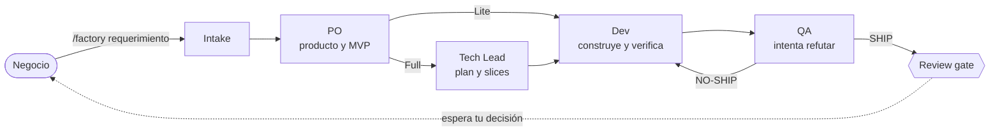
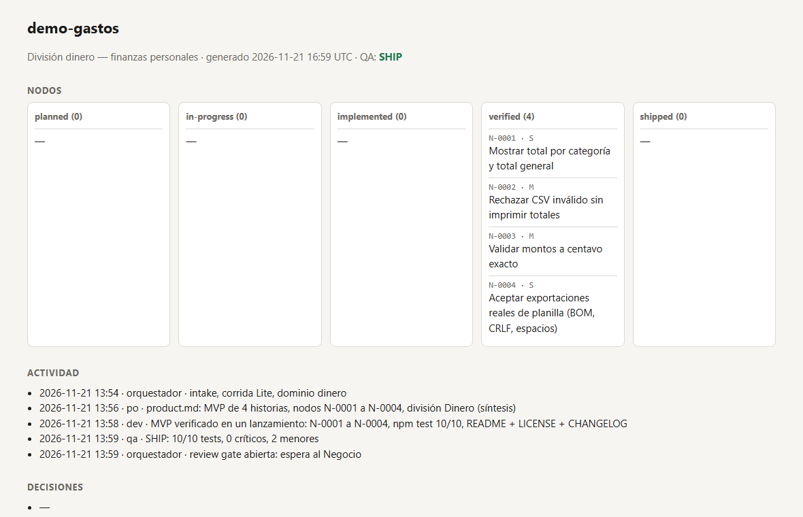

# Software Factory (Claude Code)

Fábrica de software autónoma para Claude Code sobre **brainloom-claude**. Vos sos el **Negocio**: entregás un requerimiento y la fábrica — Product Owner, Tech Lead, Dev y QA como subagents — lo construye end-to-end y se detiene una sola vez, en la **review gate**, para que apruebes el MVP y el roadmap.

Se instala **por proyecto**, dentro de su `.claude/`. No escribe nada en `~/.claude`.



## Demo: una corrida real

Todo lo de [`examples/demo-gastos/`](examples/demo-gastos) lo produjo la fábrica a partir de este pedido, sin intervención hasta la gate:

```
/factory CLI en Node que lee un CSV de gastos (fecha,categoria,monto) y muestra el total
por categoría y el total general, para freelancers que llevan sus cuentas en planillas.
Stack impuesto: Node 20, cero dependencias.
```

Entró como corrida **Lite** (un slice, sin UI, nada irreversible):

| Rol | Qué entregó | Tokens | Tiempo |
|---|---|---|---|
| orquestador | [`intake.md`](examples/demo-gastos/factory/intake.md) | — | — |
| PO | [`product.md`](examples/demo-gastos/factory/product.md) con MVP de 4 historias, 4 [nodos](examples/demo-gastos/brain/nodes) con criterios observables y, como hay dinero de por medio, la división [`division.md`](examples/demo-gastos/factory/division.md) | 41.341 | 119 s |
| Dev | [código](examples/demo-gastos/src) + [tests](examples/demo-gastos/test) + README, LICENSE y CHANGELOG del producto; 10 tests verdes y los 4 nodos cerrados con evidencia | 33.707 | 107 s |
| QA | [`qa-report.md`](examples/demo-gastos/factory/qa-report.md): **SHIP** tras unos 25 CSV hostiles, 0 críticos, 2 menores | 21.570 | 56 s |
| **Total** | 3 lanzamientos, 5 minutos de reloj del intake a la gate | **96.618** | 281 s |

Los tokens son los que reporta Claude Code por subagent; no incluyen al orquestador. El mismo pedido con la versión 0.3 (corrida Full, 6 lanzamientos) costó 273.622. En esta corrida el PO usó haiku; medido aparte en sonnet, que es como quedó, hace lo mismo con 16.274 tokens.



Lo que el Negocio recibe en la **review gate**, y donde la fábrica se detiene:

> **MVP**: `node src/cli.js examples/gastos.csv` imprime el total por categoría y el general, exactos al centavo. Un CSV inválido da error con número de línea y ningún total.
> **Verificación**: QA dice SHIP. 10/10 tests. Dos hallazgos menores: una categoría llamada "Total" se confunde con la línea de total, y los CSV inválidos de prueba viven dentro de los tests. Sin probar: archivos muy grandes.
> **Roadmap**: V1 filtro por rango de fechas; V2 separador `;` con coma decimal y salida JSON.
> **Decisiones para vos**: 1) ¿Aceptar `;` y coma decimal, lo que exporta Excel en español, ya en el MVP? Recomendado: sí, es el archivo real de tus usuarios. 2) ¿Rechazar montos negativos (reembolsos)? Recomendado: aceptarlos en V1.

Probalo vos:

```bash
cd examples/demo-gastos
npm test
node src/cli.js examples/gastos.csv
```

## Instalar en un proyecto

Requisito: `node`.

```bash
node install.mjs <carpeta-del-proyecto>              # instala o actualiza
node install.mjs <carpeta-del-proyecto> --uninstall  # la quita; brain/ y factory/ quedan
```

Qué deja en `<proyecto>/.claude/`:

```
skills/factory/        orquestador (/factory), nodes.mjs, board.mjs, references/, divisions/
skills/brainloom/      flujo de build de brainloom-claude
agents/                factory-po, factory-tech-lead, factory-design, factory-dev, factory-qa
                       + planner, scout, verifier (brainloom-claude)
brainloom-claude/      init.mjs y templates para crear brain/ sin tokens
```

Reinstalar es seguro: esas rutas se borran antes de copiar. Son del kit; no guardes ahí archivos propios. El resto de `.claude/` (settings, otros agents) no se toca.

### Con GitHub Actions

Copiá [`examples/install-factory.yml`](examples/install-factory.yml) a `.github/workflows/` del proyecto destino. Desde Actions → **Install software factory** → *Run workflow*, instala o actualiza la fábrica y commitea `.claude/` en la rama elegida.

O usá la action en un workflow propio (instala, no commitea):

```yaml
- uses: actions/checkout@v4
- uses: fedesauzzadev/software-factory-claude@main
```

Para que funcione:
- Este kit tiene que estar publicado en GitHub como `fedesauzzadev/software-factory-claude` (o cambiá el `uses:`).
- Si el kit es privado: en su repo, Settings → Actions → General → Access, permití el acceso desde tus otros repos.
- El proyecto destino no puede tener `.claude` en `.gitignore`, y la rama no puede estar protegida contra push del workflow.

## Usar

```
/factory Una API que genere facturas PDF desde JSON, en Node, vendible a contadores
/factory                      # estado del proyecto actual
```

| Rol | Cuándo | Entrega |
|---|---|---|
| orquestador | siempre | `factory/intake.md`, `brain/` (script, cero tokens), elige corrida Lite o Full |
| `factory-po` | siempre | `factory/product.md`: spec, backlog con corte MVP ≤4, roadmap; nodos `planned`; división de dominio si aplica |
| `factory-tech-lead` | Full, o para desbloquear | `factory/plan.md`, decisiones, slices |
| `factory-design` | Full con UI | `factory/design.md`: flujos, tokens, criterios de usabilidad |
| `factory-dev` | siempre | código + tests + nodos `verified` con evidencia |
| `factory-qa` | siempre | `factory/qa-report.md` con SHIP / NO-SHIP |
| orquestador | gate | `factory/board.html` + MVP, verificación, roadmap, decisiones → **espera tu aprobación** |

**Lite** (por defecto) es `PO → Dev → QA`: todo lo que entra en un slice, sin UI nueva ni nada irreversible. **Full** suma Tech Lead y Design. Si el Dev ve que no entra, devuelve `SPLIT` y la corrida pasa a Full.

## Dónde ahorra tokens

| Mecanismo | Efecto |
|---|---|
| Herramientas acotadas por rol | un agent sin lista hereda todas las de la sesión y arranca con un contexto enorme; el test del kit lo impide |
| Corrida **Lite** por defecto | un solo lanzamiento de Dev, sin Tech Lead |
| Menos slices en Full | cada lanzamiento de Dev tiene costo fijo; se parte solo si no entra en los límites |
| Deltas refinados o S | no pasan por la fábrica |
| `nodes.mjs` y `board.mjs` | los nodos del brain y el tablero los generan scripts, no el modelo |
| Orquestador que no lee | arma la gate con las ≤6 líneas que devuelve cada rol; un mensaje por fase |
| Roles que agrupan pasos | leen todo en un mensaje y escriben en otro |
| QA una vez por MVP | y re-verifica solo lo que falló |

## Reglas de la casa

- Nada está hecho sin un comando corrido y su resultado observado.
- Anti-bloqueo: 3 intentos distintos → Tech Lead → degradar con deuda explícita. Nunca se esconde.
- Sin DoD vendible (README, LICENSE, tests verdes, sin secrets) no hay SHIP.
- **Divisiones**: si el dominio lo exige, la fábrica suma gates propios (caché en `divisions/` o síntesis en `factory/division.md`); las que rinden se promueven al kit con tu aprobación.

## Medir una corrida completa

Las cifras de la demo son de los subagents. Para medir todo, orquestador incluido, corré la fábrica sin interfaz en una carpeta vacía con la fábrica instalada; el JSON trae `total_cost_usd`, `modelUsage` y `subagent_stats`:

```bash
claude -p "/factory <requerimiento>" --model sonnet --output-format json   --permission-mode acceptEdits --allowedTools Bash Read Write Edit Glob Grep Agent Skill > corrida.json
```

Requiere haber iniciado sesión en la CLI (`claude` y después `/login`).

## Desarrollar el kit

```bash
node scripts/test.mjs   # estructura + install x2 + init + board + uninstall, en un temp dir
```

```
install.mjs                 instalador y desinstalador por proyecto
action.yml                  GitHub Action (composite) que corre el instalador
examples/                   workflow listo para copiar al proyecto destino
agents/factory-*.md         po, tech-lead, design, dev, qa
skills/factory/             SKILL.md (orquestador), nodes.mjs, board.mjs, references/, divisions/
vendor/brainloom-claude/    copia de brainloom-claude (MIT) que se instala junto
scripts/test.mjs            self-check (local y CI)
```

Actualizar brainloom-claude: reemplazá `vendor/brainloom-claude/` con `agents/`, `skills/`, `templates/`, `scripts/`, `init.mjs`, `LICENSE` y `README.md` del kit nuevo, corré el test y anotalo en el CHANGELOG.

MIT.
